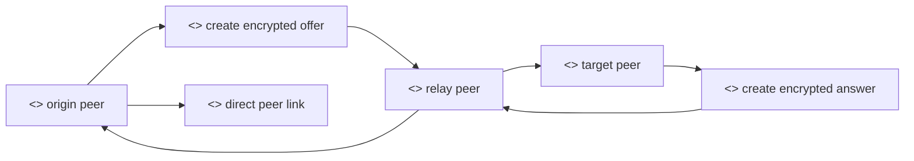
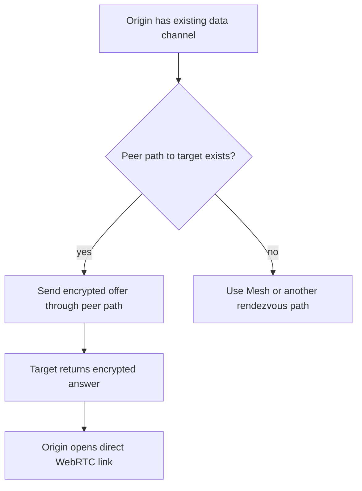

# Direct P2P Signaling

## Purpose

This document explains how signaling should look when Private Mesh is skipped or reduced. Direct P2P signaling means an existing peer connection carries bootstrap messages for another connection, instead of sending those messages through `/mesh`.

## Actors

- Origin peer: the browser that wants to open a new link.
- Target peer: the browser that should receive the offer.
- Relay peer: an already connected peer that can forward bootstrap messages.
- Private Mesh: optional fallback or initial rendezvous, not required for every edge.

## Rationale

Private Mesh is useful for the first bootstrap links, but a peer-to-peer system should become less dependent on it as the table network forms. Once some WebRTC links exist, peers can use those links to carry signaling messages for additional edges.

The goal is to reduce infrastructure dependence and make the table network self-sustaining. Mesh can help create the initial spanning tree. Non-tree routes can then be established through peer gossip, using already connected data channels.

We provide the following direct signaling operations:

- Reusing the same encrypted offer and answer payloads. The message content does not need to change only because the carrier changed.
- Forwarding through connected peers. A relay peer carries the opaque bootstrap payload to the target.
- Preserving table scope. Messages still name the lobby and table so clients can reject unrelated traffic.
- Reporting route status. Mesh may tell a peer that a route is `connect_through_peers` or `cut`, helping the client decide whether direct relay is viable.
- Falling back to Mesh when necessary. If no peer path exists, the client may need Mesh or another rendezvous path again.

## Methods

Direct P2P signaling should carry equivalent semantic messages to Mesh signaling:

- offer payload from origin to target;
- answer payload from target to origin;
- route or delivery acknowledgement where useful;
- failure notice when a relay path cannot reach the target.

The important distinction is transport. With Mesh, the carrier is `POST /mesh` plus long-poll delivery. With direct P2P signaling, the carrier is an existing WebRTC data channel.

## Mesh-Skipped Flow

1. Origin peer already has at least one WebRTC data channel.
2. Origin identifies a target peer that is not directly connected.
3. Origin creates the encrypted WebRTC offer for the target.
4. Origin sends the offer through a relay peer.
5. Relay peer forwards the opaque offer without decrypting it.
6. Target peer receives the offer and creates an encrypted answer.
7. Target sends the answer back through the same or another relay path.
8. Origin applies the answer and opens the direct WebRTC link.
9. After the link is open, future poker messages can use the direct link.

## Security Notes

Relay peers should not need plaintext SDP or private keys. They are carriers. The origin and target remain responsible for encrypting, decrypting, validating, and applying signaling payloads.

