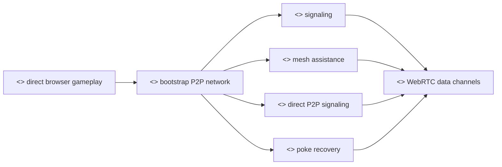

# P2P Infrastructure

## Purpose

This document is the entry point for the Private Mesh documentation set. It is intended to become Part III - P2P Infrastructure in the Private Poker reference manual.

Part III explains how browser peers find each other, how WebRTC bootstrap messages move, how Private Mesh assists without becoming the game host, how direct peer-to-peer signaling works after initial links exist, and how the `Poke` recovery action helps a player restart peer discovery.

## Chapters

- [Signaling](./signaling.md): explains what signaling is and why it is separate from gameplay.
- [Private Mesh Assistance](./private-mesh-assistance.md): explains how `/mesh` long-poll, peer queues, MST scheduling, and P2P offload assist table bootstrap.
- [Player P2P Flow](./player-flow.md): explains what the player's browser does when joining or returning to a table.
- [Direct P2P Signaling](./direct-p2p-signaling.md): explains how signaling can move through existing WebRTC links when Mesh is skipped.
- [Poke](./poke.md): explains the player-facing recovery action for stuck inbound peer discovery.
- [Mesh](./mesh.md): captures lower-level server log interpretation and MST execution examples.
- [Failure Modes](./failure-modes.md): captures failure handling, MST recomputation, P2P route status, and long-poll disconnect behavior.

## Rationale

Private Poker depends on peers communicating directly. The infrastructure goal is not to centralize gameplay; it is to help browser peers reach the point where direct communication is possible.

We provide the following infrastructure capabilities:

- Discovery: peers announce that they are present for a lobby and table.
- Rendezvous: peers exchange encrypted bootstrap payloads before a direct WebRTC link exists.
- Coordination: Mesh sequences selected connection attempts to avoid excessive simultaneous browser handshakes.
- Decentralisation path: non-tree routes can be established through direct peer signaling once some links exist.
- Recovery: users and clients can retry discovery when browser tabs, long polls, or peer connections are interrupted.
- Observability: the grid view shows recent peer and queue activity so operators can see whether bootstrap is healthy.

