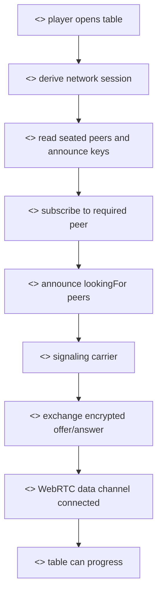

# Player P2P Flow

## Purpose

This document describes the player-facing flow for joining the Private Poker peer-to-peer network. It explains what the player's browser does after the player is seated at a table and before gameplay can begin.

## Actors

- Player: the seated account address.
- Player browser: derives table networking keys, polls mesh, and manages WebRTC.
- Previous seat: the peer normally used for the inbound ring connection.
- Next seat or target peer: the peer this browser may need to offer to.
- Private Mesh: optional bootstrap carrier for early signaling.

## Rationale

The player experience should feel like entering a poker table, not configuring networking. Under the surface, however, the browser must establish secure peer links before the hand can start. The goal is to make this process observable, recoverable, and clear: the UI can show security, peer connection, and subscription states while the network layer performs the bootstrap steps.

We provide the following player operations:

- Preparing the local network session. The browser derives or restores the BLS/network material needed for encrypted peer discovery.
- Reading table peers. The browser identifies seated players and their announce public keys.
- Subscribing to required peer links. In the current table flow, the client connects to the previous occupied seat in the token-ring topology.
- Announcing peer interest. The browser declares which peer it is looking for.
- Exchanging encrypted offers and answers. The bootstrap carrier moves opaque WebRTC setup payloads.
- Marking the link connected. After WebRTC opens, the browser can start direct data-channel traffic.
- Keeping the table locked until peers are ready. The UI should not allow gameplay to proceed while required links are missing.

## Methods

The Vite client uses the following high-level operations:

- `prepareNetworkSession`: prepares the local BLS/network identity.
- `subscribeTo`: creates or refreshes a peer subscription and schedules peer discovery.
- `pokeInboundConnection`: manually re-announces peer discovery for an inbound connection.
- `publishMessage`: sends poker protocol messages after a data channel is available.

## Procedure

1. The player opens or returns to a table.
2. The app verifies the account/session state.
3. The app reads the table seats and announce public keys.
4. The app identifies the peer it must connect to for the selected topology.
5. The app creates a local WebRTC subscription for that peer.
6. The app announces the desired peer through the available signaling path.
7. If Mesh is used, the browser long-polls `/mesh` and receives bootstrap instructions.
8. The offerer creates an encrypted WebRTC offer.
9. The target peer decrypts the offer and sends an encrypted answer.
10. The offerer applies the answer and opens the data channel.
11. The client reports the link as connected.
12. The table UI moves from waiting state toward gameplay readiness.

## Waiting And Recovery States

- `Searching`: the local browser is announcing interest and waiting for a route.
- `Connecting`: offer/answer exchange has started but the data channel is not open yet.
- `Connected`: the direct WebRTC link is ready.
- `Disconnected`: the long-poll or peer link dropped.
- `Poke`: the player can manually re-announce discovery when an inbound connection appears stuck.

