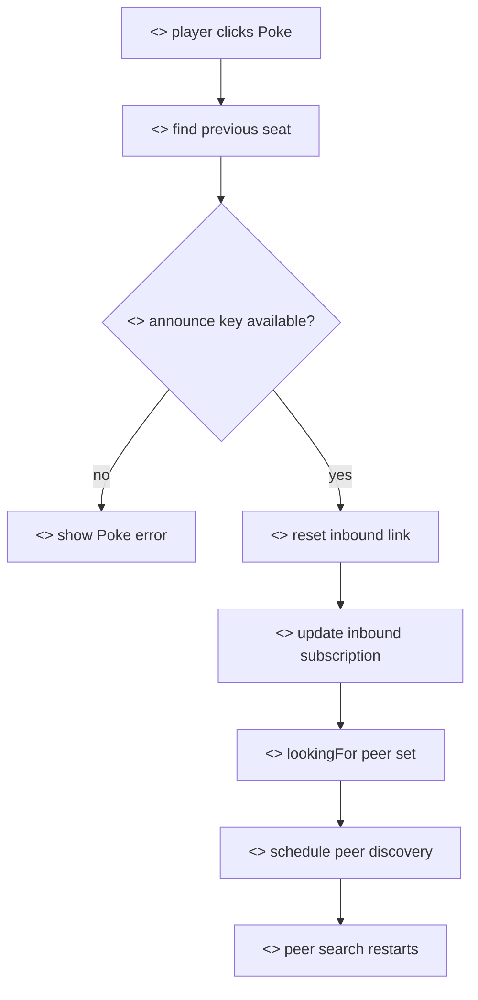

# Poke

## Purpose

This document explains the `Poke` action in the Private Poker table rejoin flow. Poke is a player-facing recovery action that re-announces peer discovery for an inbound connection that appears stuck.

## Actors

- Player: clicks `Poke` from the table rejoin dialog.
- Player browser: resets and re-announces the inbound peer search.
- Previous seat: the peer the local player expects to receive a connection from in the ring topology.
- Signaling carrier: Mesh or direct peer signaling, depending on what is available.

## Rationale

Peer-to-peer tables are live browser sessions. A player may reopen a tab, arrive late to the table screen, miss a previous discovery message, or lose a long-poll request. The UI needs a small, understandable recovery action that does not alter funds, table membership, or contract state.

Poke exists for that reason. It is a networking nudge. It tells the local browser to try inbound discovery again for the previous seat, using the peer's announce public key. It does not force the remote peer to connect, and it does not change the poker result.

We provide the following recovery operations:

- Checking the previous occupied seat. The table flow identifies which peer should connect inbound.
- Reusing the peer announce public key. Poke needs the previous peer's announce key so encrypted discovery can be prepared.
- Resetting the local inbound link state. Stale local connection state is cleared for that peer.
- Recreating or updating the inbound subscription. The browser makes sure it is listening for that peer again.
- Adding the peer to the local `lookingFor` set. This causes the next discovery cycle to announce interest in that peer.
- Scheduling peer discovery. The client gives Mesh or direct P2P signaling another opportunity to deliver bootstrap messages.

## Methods

The current Vite flow calls:

- `retryInboundConnection`: table-level action used by the rejoin dialog.
- `pokeInboundConnection`: network/session action that resets the inbound peer link and schedules discovery.

## Procedure

1. The table rejoin dialog shows the peer connection step.
2. If the inbound connection is not progressing, the UI exposes `Poke`.
3. The player clicks `Poke`.
4. The app looks up the previous occupied seat.
5. The app checks that the previous peer has an announce public key.
6. The network session creates or updates the inbound subscription.
7. The network session resets the local inbound link state for that peer.
8. The peer is added to `lookingForPeers`.
9. Peer discovery is scheduled again.
10. The UI resumes showing `Searching` or `Connecting` until the link opens or errors.

## What Poke Does Not Do

- It does not send a smart-contract transaction.
- It does not change table ownership, table membership, chips, or settlement state.
- It does not bypass account verification or subscription rules.
- It does not decrypt remote peer messages.
- It does not guarantee that the remote peer is online.

