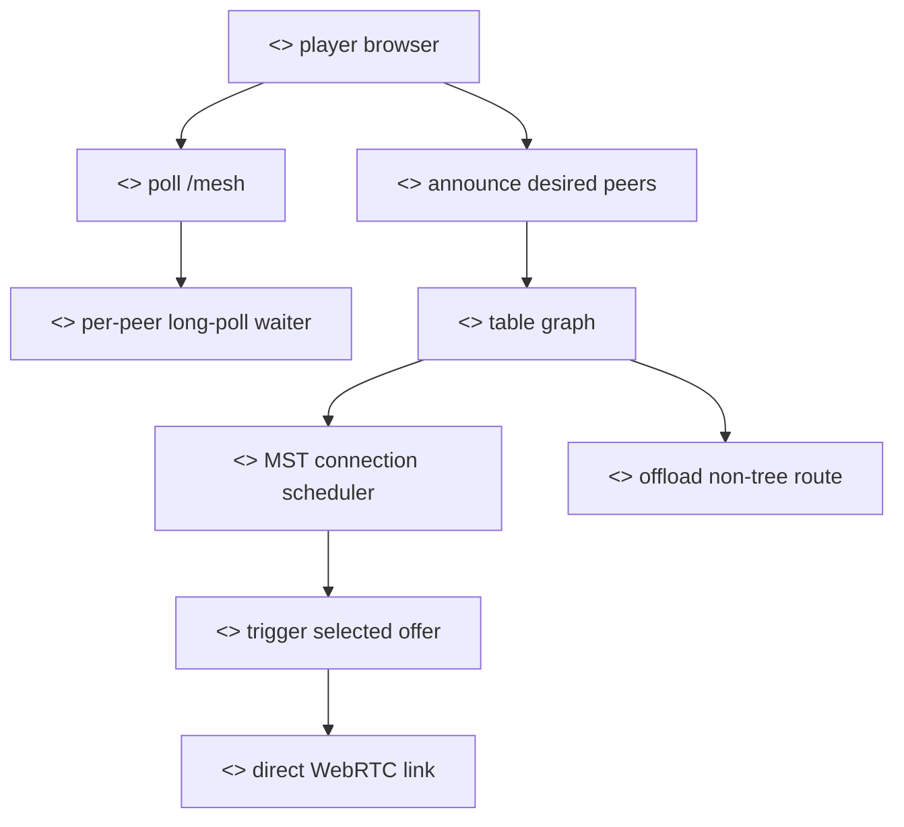

# Private Mesh Assistance

## Purpose

This document explains how Private Mesh assists browser peers during WebRTC bootstrap. Private Mesh is an HTTP long-poll relay and coordination service. It helps peers find each other and sequence connection attempts, but it is not the poker host.

## Actors

- Player browser: polls Private Mesh and sends bootstrap messages.
- Private Mesh: stores short-lived queues, waiters, peer activity, and table connection graphs.
- Remote peer: receives offers, sends answers, and acknowledges connected links.
- Poker table: the logical lobby/table scope that groups peer bootstrap work.

## Rationale

Private Poker is designed to be peer-to-peer, but browser peers still need a rendezvous path before they have direct data channels. Private Mesh provides that path with a small operational role: it helps players exchange encrypted WebRTC bootstrap messages and avoid too many simultaneous handshakes.

The goal is to make table bootstrap more reliable without turning Private Mesh into a central game server. It coordinates startup, tracks failures, exposes telemetry, and then gets out of the way once peers can communicate directly.

We provide the following operations:

- Long-poll rendezvous. Each player keeps a `/mesh` request open so queued messages can be delivered without requiring a persistent WebSocket.
- Peer announcement. A player announces the table and the peers it is looking for.
- Graph coordination. Private Mesh records requested peer edges for a table and computes a minimum spanning tree for core connection attempts.
- Sequential WebRTC triggering. Mesh triggers one selected offer at a time, reducing STUN/ICE pressure and connection collisions.
- P2P offload. Edges outside the tree are reported as routes that should be established through existing peer connections when possible.
- Failure recovery. Failed handshakes are reported back to Mesh, which can recompute the remaining table graph.
- Telemetry. `/mesh/grid` exposes recent peer, queue, waiter, and signal activity for operations and debugging.

## Methods

Private Mesh exposes two HTTP entry points:

- `POST /mesh`: receives peer long-poll requests and outbound bootstrap messages, then returns queued inbound messages.
- `GET /mesh`: returns service status, including mode, queue counts, waiter counts, and timeout settings.
- `GET /mesh/grid`: returns operational telemetry for the grid UI.

## Storage Model

Private Mesh state is in-memory and short-lived:

| Collection | Meaning |
| --- | --- |
| `queues` | Messages waiting for a peer's next poll response |
| `waiters` | Long-poll responses currently parked for peers |
| `interests` | Offer/answer state for active bootstrap exchanges |
| `tableNodes` | Recently active peers grouped by lobby/table |
| `tableEdges` | Requested peer-to-peer connection edges |
| `tableExecutions` | Current MST queue and active handshake timer |
| `peerActivity` | Recent peer telemetry for the grid |

## Operating Boundary

Private Mesh should be considered bootstrap infrastructure. It may assist connection setup, but gameplay messages, poker state validation, and settlement authority belong outside it. Once WebRTC is connected, peers should exchange poker protocol messages directly.

