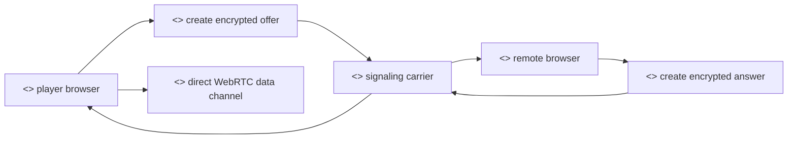

# Signaling

## Purpose

This document explains signaling in the Private Poker peer-to-peer network. Signaling is the short bootstrap exchange that lets two browser peers discover how to open a WebRTC connection. It is not gameplay and it is not table settlement.

## Actors

- Player: the wallet identity seated at a poker table.
- Browser peer: the player's running tab, holding the local WebRTC session.
- Remote peer: another seated player that must be reached.
- Signaling carrier: either Private Mesh, Postgres-backed Saga state, an existing WebRTC peer, or another relay path that can carry encrypted bootstrap messages.

## Rationale

WebRTC peers cannot usually connect by simply knowing each other's wallet address. Browsers must exchange connection metadata, including offer and answer material, before a data channel can open. Signaling is the process that carries this metadata between peers.

The goal is to make that bootstrap exchange minimal, encrypted, and replaceable. Private Poker should not depend on one permanent signaling server for gameplay. The signaling layer helps peers meet; after the WebRTC data channel opens, poker messages should move directly peer-to-peer.

We provide the following signaling concepts:

- A table-scoped peer identity. Signaling is always tied to a lobby, a table, and player addresses, so messages do not leak across games.
- An encrypted payload. The carrier forwards `encryptedData`; it does not need to understand the WebRTC SDP content inside.
- A sender and recipient. A signal names the origin player and the target player.
- A kind. Offer-like messages initiate a connection; answer-like messages accept it.
- A completion acknowledgement. Once a peer link is connected, the client reports that the link was established so coordination can advance.



## Methods

Signaling messages used by Private Mesh include:

- `bootstrap-announce`: declares that a peer is present for a lobby/table and lists peers it wants to reach.
- `trigger-offer`: asks a peer to create a WebRTC offer for a selected target.
- `bootstrap-interest`: carries an encrypted WebRTC offer toward the target peer.
- `bootstrap-offer`: delivers the stored offer to the target peer.
- `bootstrap-answer`: carries and delivers the encrypted answer back to the offerer.
- `link-connected`: confirms that the WebRTC link is established.
- `p2p-route-available`: asks the reverse peer to complete the follow-up direct P2P edge after the primary edge is connected, using `status: "connect_through_peers"`.
- `link-failed`: reports that the WebRTC attempt failed.

## Message Shape

The carrier needs only routing metadata and opaque encrypted bytes:

```json
{
  "originAddress": "0x...",
  "targetAddress": "0x...",
  "lobbyId": "1",
  "tableId": "42",
  "encryptedData": "0x...",
  "kind": "offer"
}
```

## Security Notes

The carrier should not be treated as trusted game logic. It can delay, drop, or reorder bootstrap messages, but it should not be able to read encrypted connection payloads or decide the poker result. The poker protocol still relies on peer verification, cryptographic hand history, and on-chain settlement.

Private Mesh stores encrypted SDP offer/answer payloads in Postgres only while the
flow is active. Once a flow reaches `Connected` or `ConnectedP2P`, the mesh node
clears the `data` column and keeps only the terminal Saga state.
